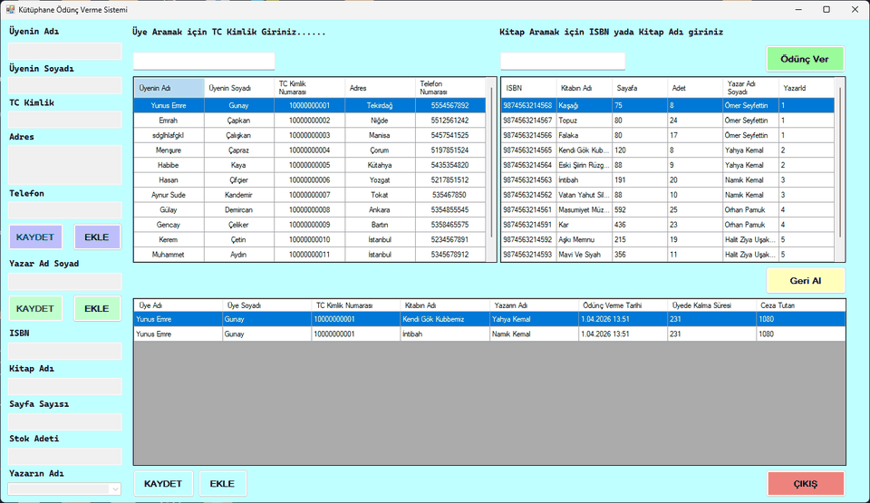
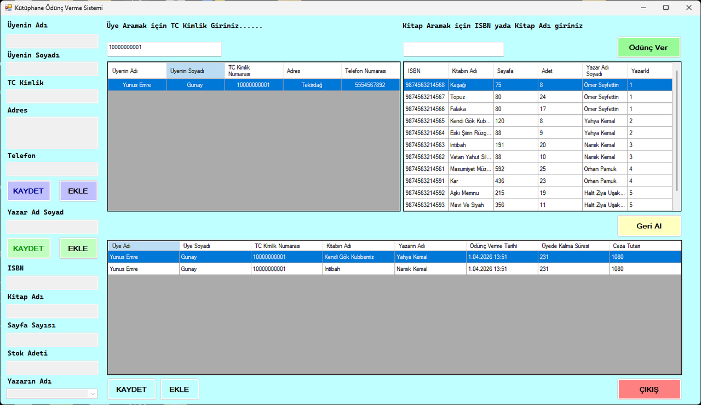
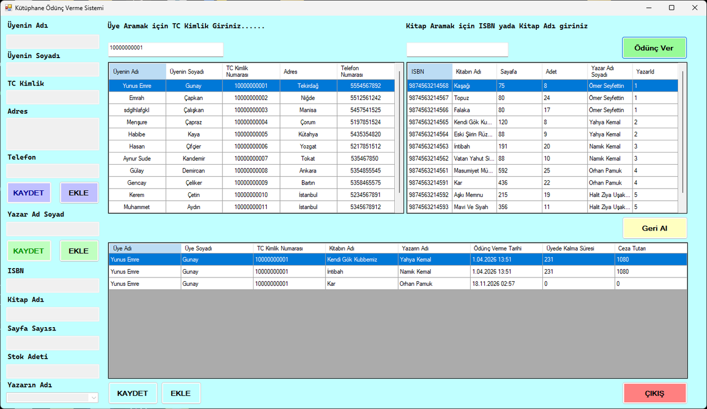

# 📚 Kütüphane Ödünç Verme Sistemi


**C# Windows Forms** ve **SQL Server** ile geliştirilmiş kütüphane otomasyonu. Üye, yazar ve kitap kaydı, ödünç verme, iade ve gecikme cezası işlemlerini yapar.

İş mantığının büyük kısmı veritabanında: **22 stored procedure** ve **1 trigger** kullanılır. Uygulama bu prosedürleri Entity Framework üzerinden çağırır.

---

## 🎬 Demo



Üye TC ile aranıyor, üyenin üzerindeki kitaplar gecikme cezasıyla listeleniyor; "Kar" ödünç veriliyor ve **Geri Al** ile iade ediliyor.

| Üyenin üzerindeki kitaplar ve ceza tutarı | Ödünç verme sonrası |
| --- | --- |
|  |  |

> Görüntüler, depodaki kurulum script'iyle kurulan örnek veritabanı üzerinde uygulama çalıştırılarak alınmıştır.


## 🚀 Özellikler

- **Üye işlemleri:** Ad, soyad, TC Kimlik, adres ve telefon ile üye kaydı; TC Kimlik ile anlık arama
- **Yazar ve kitap kaydı:** ISBN, kitap adı, sayfa sayısı, stok adedi ve yazar ile kitap ekleme; ISBN veya kitap adıyla arama
- **Ödünç verme:** Seçilen kitap üyeye verilir, stok bir azalır (`spKitapVer`)
- **İade ve ceza:** Kitap geri alınınca stok artar. 15 günü aşan her gün için kasaya ceza kaydı düşer (`KitapGeriAl4`), `trgCezaYaz` trigger'ı tutarı **gün × 5 TL** olarak hesaplar.
- **Üyenin üzerindeki kitaplar:** Ödünç süresi ve birikmiş ceza `CASE WHEN` ile hesaplanarak listelenir (`UyeIslem2`)

## 🗄️ Veritabanı (`KUTUPHANEKOVS`)

| Tablo | Açıklama |
| --- | --- |
| `TblUYELER` | Üyeler |
| `TblYAZARLAR` | Yazarlar |
| `TblKITAPLAR` | Kitaplar (ISBN benzersiz) |
| `TblUYEKITAP` | Ödünç verme / iade hareketleri |
| `TblKasa`, `TblOdemeTuru` | Ceza ve ödeme kayıtları |

**Öne çıkan T-SQL nesneleri:** `spUyeKaydet`, `spYazarKaydet`, `KitapEkle`, `spKitapVer`, `KitapGeriAl4`, `sp_TCAra`, `sp_KitapAra`, `UyeIslem2`, `trgCezaYaz` (trigger)

> Veritabanında araç kiralama denemesine ait `ARAC`, `KIRA`, `MUSTERI` tabloları da bulunur; bu uygulama onları kullanmaz.

## 📂 Proje Yapısı

```
Kutuphane-Otomasyonu/
├── KutuphaneOVS/
│   ├── KutuphaneOVS.sln        ← Visual Studio çözümü
│   └── KutuphaneOVS/
│       ├── Form1.cs            ← Tüm ekran işlemleri
│       ├── Entity/             ← Entity Framework modeli (Model1.edmx)
│       └── App.config          ← Bağlantı cümlesi
└── Veri Tabanı/
    ├── KUTUPHANEKOVS.sql       ← Kurulum script'i (tablolar + örnek veri + prosedürler + trigger)
    └── Sorgular/               ← Geliştirme sırasında yazdığım SQL sorguları
```

---

## ⚙️ Kurulum

**Gereksinimler:** Visual Studio 2022/2026 (*.NET masaüstü geliştirme* iş yükü) · SQL Server (Express yeterli) · SQL Server Management Studio (SSMS) 22

1. **İndirin**
   ```bash
   git clone https://github.com/GencayCeliker/Kutuphane-Otomasyonu.git
   ```
2. **Veritabanını kurun (SSMS 22):** Sunucuya bağlanın (`.\SQLEXPRESS`), **File → Open → File...** ile `Veri Tabanı/KUTUPHANEKOVS.sql` dosyasını açıp **Execute (F5)**'e basın.
3. **Bağlantıyı kontrol edin:** `KutuphaneOVS/KutuphaneOVS/App.config` içindeki `KUTUPHANEKOVSEntities` bağlantısı `data source=.\SQLEXPRESS` kullanır. SQL Server'ınız varsayılan örnekse `data source=.` yapın.
4. **Çalıştırın:** `KutuphaneOVS/KutuphaneOVS.sln` dosyasını Visual Studio ile açın. NuGet paketleri otomatik geri yüklenir; **F5** ile başlatın.

> Örnek verilerdeki TC Kimlik ve telefon numaraları gerçek değildir.

## 📄 Lisans

Bu proje [MIT](LICENSE) lisansı altında sunulmuştur.
